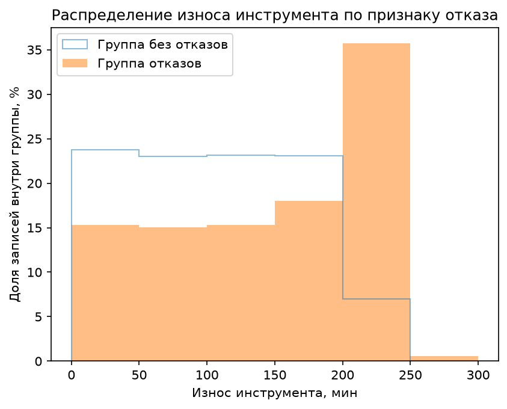
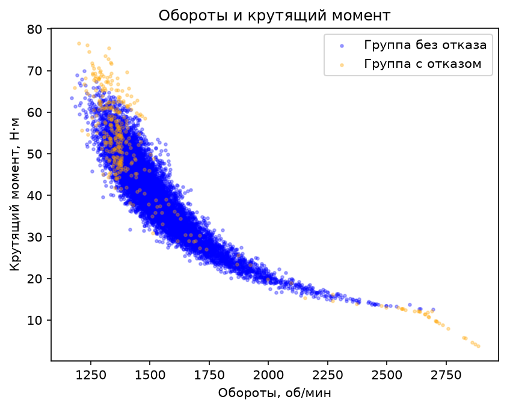

# Исследование данных оборудования — EDA

Учебный EDA-проект: анализ качества данных оборудования, сравнение записей
с отказом и без отказа, два графика и сводная таблица результатов.

На 01.11.2026 анализ реализован, семь автоматических тестов проходят.
Финальный review и Git-checkpoint ещё не завершены. Проект не обучает
ML-модель и не предназначен для управления оборудованием.

Цель: проверить качество данных и исследовать различия параметров между
записями с отказом и без него, подкрепив выводы числами и графиками.
Связь показателей не доказывает причину отказа.

## Источник

[AI4I 2020, UCI](https://doi.org/10.24432/C5HS5C), 2020,
лицензия CC BY 4.0. Набор синтетический, моделирует промышленные данные;
выводы нельзя напрямую переносить на реальное оборудование.
Исходный CSV сохранён без изменений в data/raw/ai4i2020.csv.
Источник загрузки, дата и SHA-256 — data/raw/source.json.

Одна строка — запись набора; UDI — идентификатор записи, Product ID —
идентификатор продукта, не автоматически идентификатор станка.
Температура дана в кельвинах, обороты в rpm, момент в Н·м,
износ инструмента в минутах. Machine failure — метка отказа;
TWF/HDF/PWF/OSF/RNF — индикаторы видов отказа, не независимые датчики.

## Запуск

Проверенная среда: Python 3.13, pandas 3.0.4, NumPy 2.5.1,
Matplotlib 3.11.1, pytest 9.2.0. Полные зависимости учебного репозитория
закреплены в корневом `requirements.txt`; это не минимальный набор только EDA.

В PowerShell перейдите в корень учебного репозитория. При первом запуске
создайте окружение, затем активируйте его и установите зависимости:

```powershell
python -m venv .venv
.\.venv\Scripts\Activate.ps1
python -m pip install -r requirements.txt
```

Если окружение уже создано, повторять первую команду не нужно.
Перед запуском нужен `projects/machine_eda/data/raw/ai4i2020.csv`.
Если файла нет, скачайте архив по адресу `source` из `data/raw/source.json`
и поместите исходный `ai4i2020.csv` в `data/raw/`, сохранив имя и содержимое.
Загрузка данных в самом скрипте не выполняется.

Запустите анализ из корня репозитория:

```powershell
python projects/machine_eda/analysis.py
```

Откроются два графика по очереди: закройте первый, чтобы продолжить выполнение,
затем второй. После этого скрипт завершит вывод и сохранит сводный CSV.
Для обычного запуска нужна среда с отображением окон Matplotlib.
Пути к входным и выходным файлам строятся относительно `analysis.py`,
а не текущей рабочей папки.

## Файлы и устройство

| Файл | Назначение |
|---|---|
| `analysis.py` | Загрузка, расчёты, графики и основной сценарий `main` |
| `test_analysis.py` | Семь pytest-проверок двух функций расчёта долей |
| `data/raw/ai4i2020.csv` | Исходные данные |
| `data/raw/source.json` | Источник, лицензия, дата загрузки и SHA-256 исходного CSV |
| `wear_distribution.png` | Распределение износа в процентах внутри каждой группы |
| `speed_torque_scatter.png` | Обороты и крутящий момент с разделением по метке отказа |
| `group_summary.csv` | Количество записей, средние и медианы по группам |

Графики и сводный CSV создаются рядом с `analysis.py`; при обычном повторном
запуске файлы с этими именами перезаписываются. Исходный CSV не изменяется.

Функции отделяют загрузку, расчёт доли отказов, расчёт доли выбранной области,
групповую сводку и два графика. `main` связывает шаги. Защита
`if __name__ == "__main__"` не запускает весь анализ при импорте функций в тесты.

В `group_summary.csv`:
- `Machine failure`: 0 — без отказа, 1 — с отказом;
- `record_count`: число записей;
- `mean_wear`, `median_wear`: наработка инструмента в минутах;
- `mean_torque`, `median_torque`: крутящий момент в Н·м;
- `mean_rotational_speed`, `median_rotational_speed`: обороты в об/мин.

## Проверки

Из корня репозитория с активным окружением:

```powershell
python -m pytest projects/machine_eda/test_analysis.py -q
```

Ожидаемый результат текущего набора: `7 passed`.

Четыре теста `calculate_failure_percent` проверяют обычные данные (25% и 60%),
отсутствие отказов (0%) и отсутствие записей (`None`). Три теста
`calculate_region_percent` проверяют строгие границы условий, отсутствие
подходящих строк (0%) и пустую таблицу (`None`). Область определяется как
обороты < 1500 об/мин **и** момент > 50 Н·м; равные границам значения исключены.

Для гистограммы отдельно проверены четыре сочетания пустых и непустых групп:
пустая группа пропускается, при двух пустых выводится сообщение без создания
и сохранения графика. Эти проверки выполнены ментором отдельно от семи
pytest-тестов; сохранение и показ при них подменялись, файлы не записывались.
После правок также выполнен полный запуск на исходных данных.
Семь тестов не означают проверку всего приложения, любых CSV и всех графиков.

## Качество исходных данных

В проверенном исходном наборе 10 000 строк и 14 столбцов: 9661 запись
без отказа и 339 с отказом, доля записей с отказом — 3,39%.
Пропусков, полностью повторяющихся строк и повторов UDI не обнаружено.
Поэтому значения не заполнялись и строки не удалялись ради формальной очистки.
Подозрительные значения требуют исследования, а не автоматического удаления.

## Результаты

### Наработка инструмента



Сравнили среднюю и медианную наработку инструмента, а также размах
в записях с отказом и без отказа.

| Наработка инструмента, мин | Без отказа | С отказом |
|---|---:|---:|
| Среднее | 106,69 | 143,78 |
| Медиана | 107 | 165 |
| Размах | 246 | 253 |

В записях с отказом средняя и медианная наработка инструмента больше,
а размах в обеих группах близок. Наблюдение относится к группам в целом,
а не к каждому инструменту по отдельности. Оно показывает связь в данном
наборе, но не доказывает, что наработка инструмента стала причиной отказов.

Среди записей с отказом чаще всего встречается износ 200–250 минут —
35,69% записей этой группы. Среди записей без отказа на тот же интервал
приходится 7,02%. Проценты рассчитаны отдельно внутри каждой группы.
«Чаще всего» относится к выбранным интервалам гистограммы шириной 50 минут;
интервал 200–250 включает 200 минут и не включает 250 минут.

### Крутящий момент и обороты



В данном наборе средний крутящий момент в группе с отказом на 10,54 Н·м
больше, чем в группе без отказа: 50,17 против 39,63 Н·м. Это разница
групповых средних, которая сама по себе не доказывает причину отказов.

Средние обороты в группе с отказом ниже: 1496,49 против 1540,26 об/мин;
медианы также ниже: 1365 против 1507 об/мин. На диаграмме группы пересекаются.

В области оборотов < 1500 об/мин и крутящего момента > 50 Н·м находится
211 записей с отказом — 62,24% этой группы, и 1321 запись без отказа —
13,67% этой группы. Область чаще встречается среди записей с отказом,
но содержит и записи без отказа, поэтому не позволяет безошибочно
определять отказ. Границы выбраны для исследования этого набора данных
и не являются нормативами безопасной работы оборудования.

## Ограничения и инженерные решения

- Набор синтетический; групповые различия не доказывают причинность и не
  устанавливают безопасные режимы реального оборудования.
- Группы неравны по размеру. Гистограммы нормированы внутри каждой группы,
  иначе количество записей без отказа подавляло бы сравнение.
- 62,24% — доля выбранной области среди записей с отказом, а не вероятность
  отказа среди всех записей этой области. Знаменатель имеет значение.
- Наработка инструмента — не время работы оборудования до отказа.
- Контракт расчётов различает 0% (записи есть, событий нет) и `None`
  (нет записей). Отдельные проверки групп предотвращают деление на ноль
  при построении гистограммы.
- Полная обработка отсутствующего/повреждённого CSV, произвольной схемы,
  неверных типов и пропусков во входе не реализована. На основном сценарии
  предполагается исходный CSV с указанной структурой.
- Отсутствие новых данных не удаляет PNG, сохранённый предыдущим запуском:
  при двух пустых группах функция просто не сохраняет новый график.

Основные трудности проекта: сравнение групп разного размера, корректная
интерпретация процентов, отделение расчёта от вывода и обработка пустых групп.
Решения — нормирование гистограмм, явные подписи, отдельные функции,
ранний выход и проверки на небольших контролируемых примерах.
